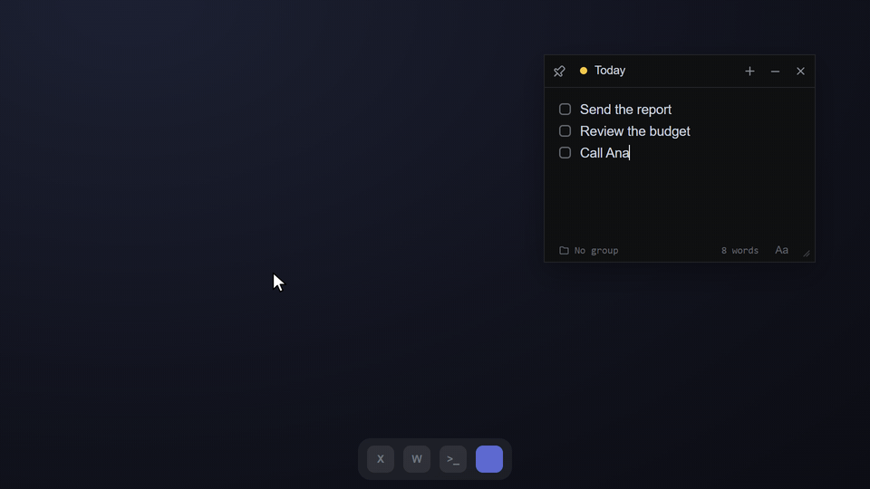

  

<h1 align="center">Memo</h1>

  <b>Sticky memories you pin on top of everything.</b> 
  A small, free notes app for Windows, macOS and Linux.

  <a href="https://danielakio.github.io/memo/"><b>Website & download</b></a> · <a href="https://danielakio.github.io/memo/app.html"><b>Use in browser</b></a>

  <picture>
    <source media="(prefers-color-scheme: light)" srcset="site/media/pitch-light-en.gif">
    
  </picture>

Every memory is its own little window. Click the **pin** and it floats over every other app; set a **reminder** and
it comes back on top right on time. Memories save themselves, gather in groups and boards, share as a link, and can
sync through your own Google Drive or OneDrive.
There is no sign-up, no ads and no tracking.

Features, downloads and help for the first launch are all on the **[website](https://danielakio.github.io/memo/)**.

## Ideas and bug reports

**[Report a bug](https://github.com/DanielAkio/memo/issues/new?template=bug_report.yml)** or
**[suggest an improvement](https://github.com/DanielAkio/memo/issues/new?template=feature_request.yml)**, in English
or Portuguese. If the same idea is already in the [open issues](https://github.com/DanielAkio/memo/issues), give it
a 👍.

## For developers

Memo is built with [Tauri 2](https://v2.tauri.app) (Rust + plain HTML/CSS/JS). Building, running in development and
making installers are covered in **[docs/development.md](docs/development.md)**. Windows installers are signed for
free by SignPath Foundation under this [code signing policy](https://danielakio.github.io/memo/code-signing.html).

## License

[MIT](LICENSE). Free to use, share and change.
