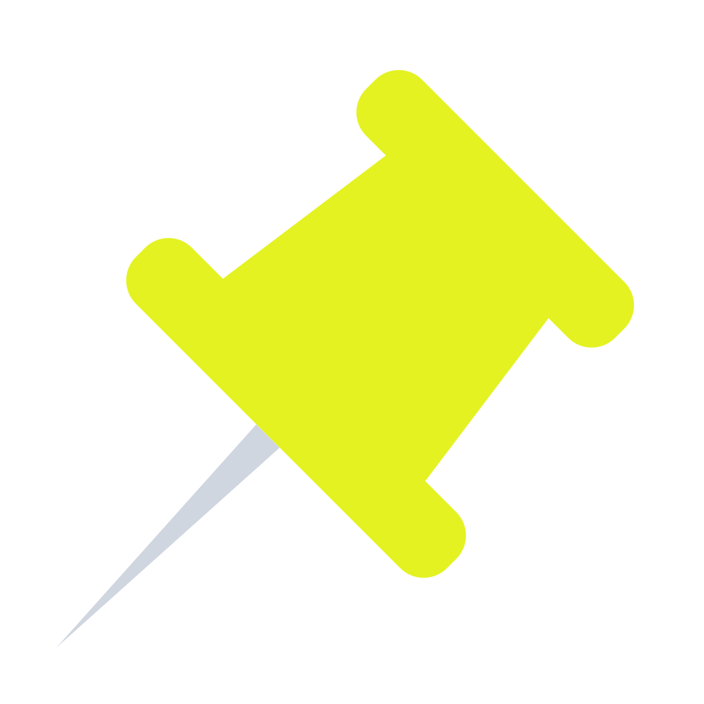
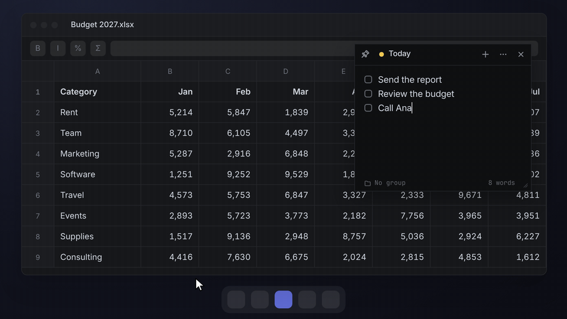
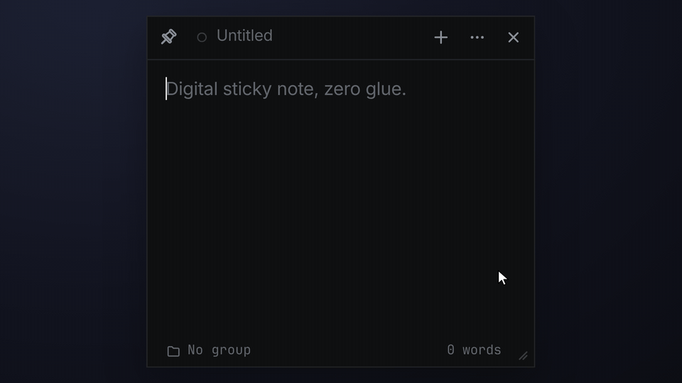
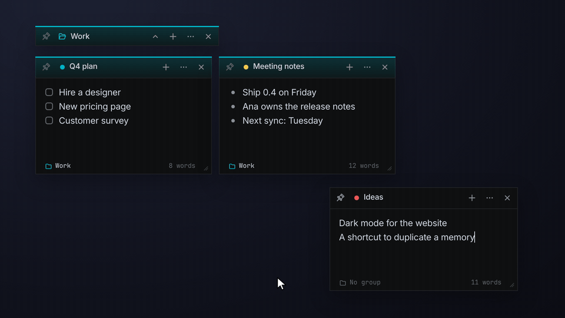
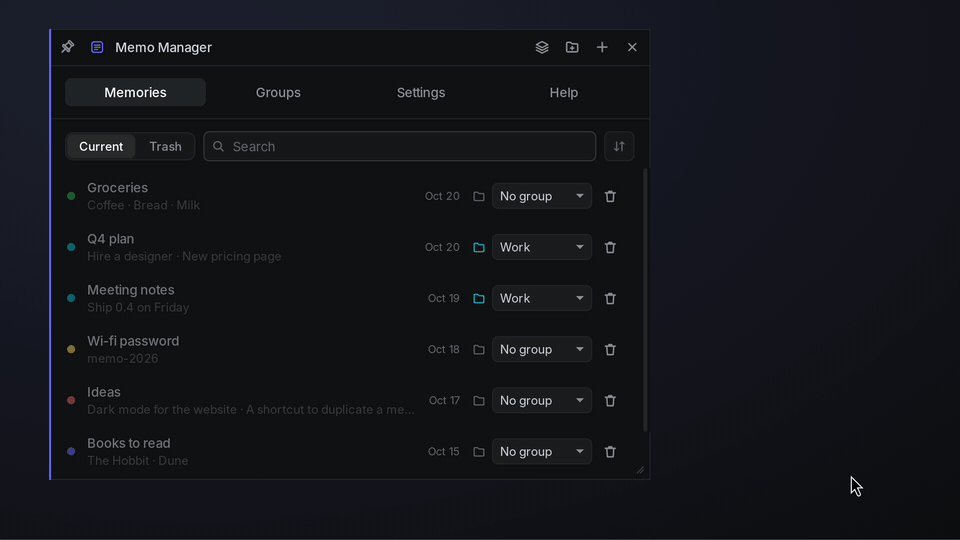

  

<h1 align="center">Memo</h1>

  <b>Sticky memories you pin on top of everything.</b> 
  A small, free notes app for Windows, macOS and Linux.

  <a href="https://github.com/DanielAkio/memo/releases/latest"><b>Download</b></a> ·
  <a href="https://danielakio.github.io/memo/">Website</a> ·
  <a href="https://danielakio.github.io/memo/pt/">Em português</a>

  <picture>
    <source media="(prefers-color-scheme: light)" srcset="site/media/pin-light-en.gif">
    
  </picture>

Every memory is its own little window. Click the **pin** and it floats over every other app: the to-do list next to
the spreadsheet, the phone number during the call, the command you always forget above the terminal. No more
digging through windows to find what you wrote down.

## Why people like it

- **Always in sight.** One click on the pin and the memory stays on top while you work in anything else.
- **Write without thinking.** Type and it's saved. `[]` starts a checklist, `-` starts a list, and a quick selection
  lets you highlight what matters.
- **Find things at a glance.** Give each memory a title and a colour, and gather related ones in a group you can put
  away and bring back in one click.
- **Yours, and only yours.** No sign-up, no ads, no tracking, and it works offline. Your memories live on your
  computer, and if you want them on several computers, they sync through your own Google Drive
  ([privacy policy](https://danielakio.github.io/memo/privacy.html)).

## Jot it down in seconds

  <picture>
    <source media="(prefers-color-scheme: light)" srcset="site/media/write-light-en.gif">
    
  </picture>

Name it with a double-click on the top bar, type `[]` for a checklist, tick items as you go, highlight a line and pick
a colour. That's all there is to learn.

## Keep related memories together

  <picture>
    <source media="(prefers-color-scheme: light)" srcset="site/media/group-light-en.gif">
    
  </picture>

A group is a slim bar that holds memories. The arrow tucks them all into the bar and brings them back exactly where
they were. Drop a memory on a bar to add it.

## Everything in one place

  <picture>
    <source media="(prefers-color-scheme: light)" srcset="site/media/manager-light-en.gif">
    
  </picture>

The **Memo Manager** lists every memory, open or closed. Search them, reopen one with a click, move it to a group or
sort the list. Sent something to the trash by mistake? Restore it: the trash keeps memories for 30 days.

## Let your AI assistant take notes

Turn on **AI control** in Settings and connect Claude (or any app that speaks [MCP](https://modelcontextprotocol.io))
with one click. Then just ask: *"put my shopping list in a yellow memory and pin it"*, *"what's in my Work group?"*,
*"tick off coffee"*. Your assistant finds, reads, writes, pins, colors and groups memories, and you watch them
change on screen. It's off until you turn it on, only apps on your computer can connect, and deleting for good stays
in your hands.

## Get Memo

Download the installer for your computer from the **[latest release](https://github.com/DanielAkio/memo/releases/latest)**:

| Your computer | File to download |
| --- | --- |
| Windows 10 or 11 | the one ending in `-setup.exe` |
| Mac with Apple chip (M1, M2…) | the `.dmg` with `aarch64` in its name |
| Mac with Intel chip | the `.dmg` with `x64` in its name |
| Linux | `.deb` (Ubuntu, Debian, Mint), `.rpm` (Fedora, openSUSE) or `.AppImage` (any) |

Open it, and Memo greets you with a welcome memory that shows the basics. Closing a memory never deletes it, and
closing the last one keeps Memo in the system tray (the menu bar on a Mac), ready for the next idea.

<b>Your computer warns you the first time?</b>

Memo is new and its installers aren't signed yet, so your system may be cautious the first time. It only happens
once:

- **Windows**: if you see "Windows protected your PC", click **More info → Run anyway**.
- **macOS**: drag Memo to Applications, then right-click it → **Open**. If macOS still refuses, go to **System
  Settings → Privacy & Security** and click **Open Anyway**. If it says the app "is damaged", run
  `xattr -cr /Applications/Memo.app` in Terminal and open it again.
- **Linux**: install the `.deb` or `.rpm` with your package manager, or make the `.AppImage` executable
  (`chmod +x Memo*.AppImage`) and run it.

## Ideas and bug reports

Memo gets better with your feedback. **[Report a bug](https://github.com/DanielAkio/memo/issues/new?template=bug_report.yml)**
or **[suggest an improvement](https://github.com/DanielAkio/memo/issues/new?template=feature_request.yml)**, in
English or Portuguese. If someone already asked for the same thing in the
[open issues](https://github.com/DanielAkio/memo/issues), a 👍 on it helps too.

---

## For developers

Memo is built with [Tauri 2](https://v2.tauri.app) (Rust + plain HTML/CSS/JS). How to build it, run it in
development and make installers is in **[docs/development.md](docs/development.md)**. Windows installers are signed
for free by SignPath Foundation under this [code signing policy](https://danielakio.github.io/memo/code-signing.html).

## License

[MIT](LICENSE). Free to use, share and change.
